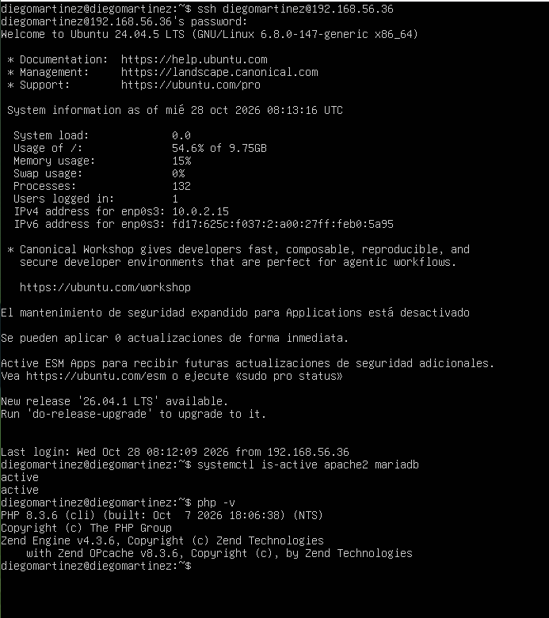
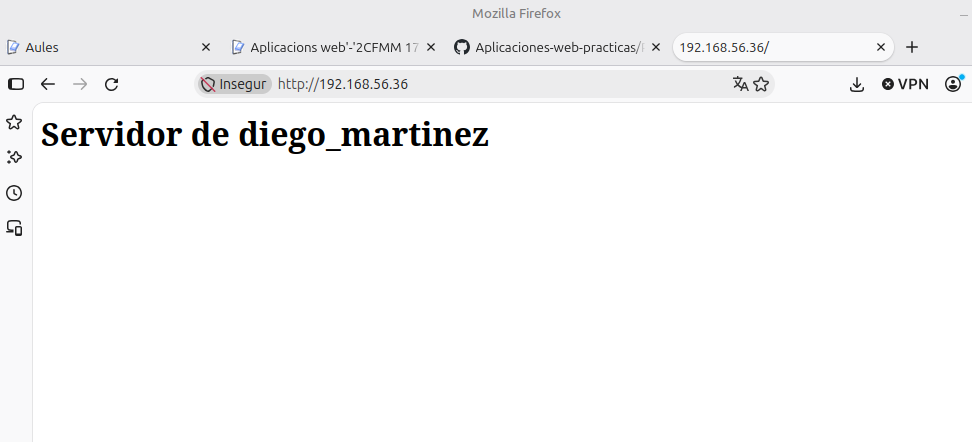
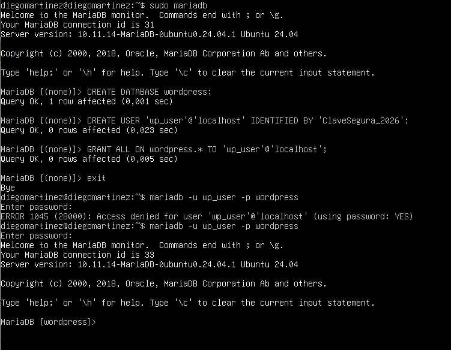
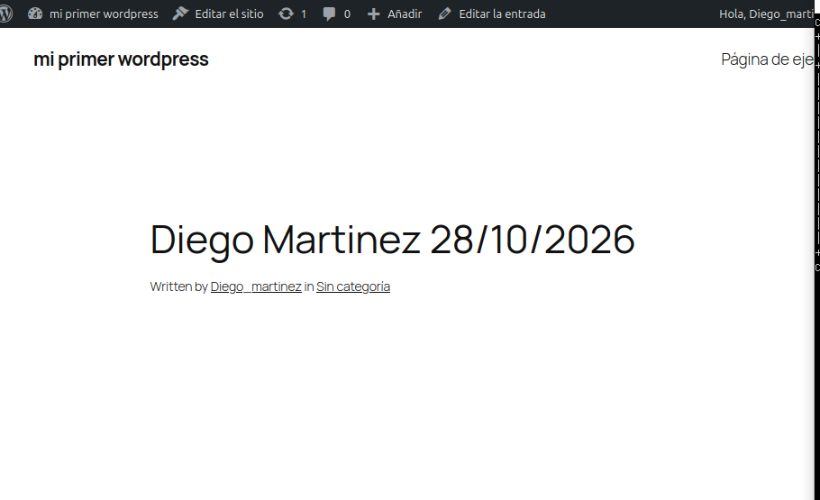
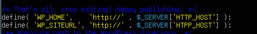
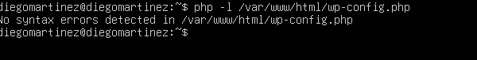
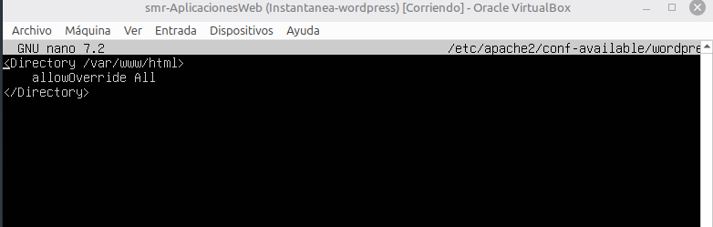
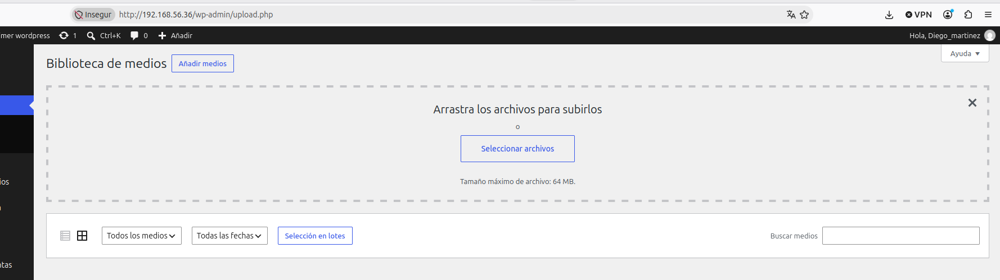
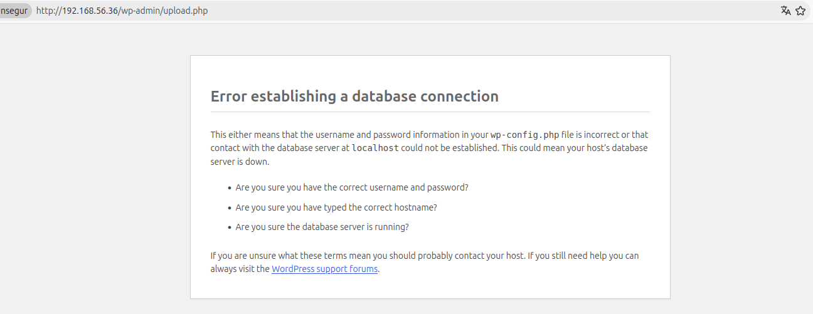
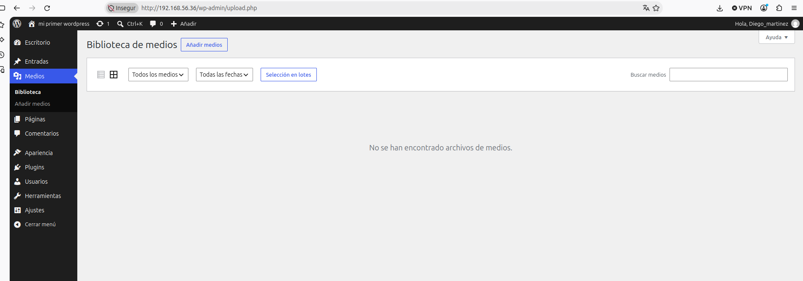

# Información Personal
## Nombre: Diego Alejandro Martínez Rojas
## Curso: 2 Smx
## Fecha: 16/10/2026

# Apartado 1. Conexión por SSH y comprobación del servidor
Apartado 1. Conexión por SSH y comprobación del servidor
1.1. Averigua la IP del servidor. Con la consola de la máquina virtual (o ya conectado por SSH), ejecuta:
```bash
hostname -I
```
Apunta la IP que aparezca (por ejemplo, 192.168.56.10).

1.2. Conéctate por SSH desde tu ordenador. Abre una terminal en tu ordenador (en Windows, PowerShell) y escribe:
ssh TU_USUARIO@IP_DEL_SERVIDOR
La primera vez te preguntará si confías en el servidor: escribe yes. Después te pedirá la contraseña de tu usuario. A partir de aquí, todos los comandos de la práctica se escriben en esta terminal.

1.3. Comprueba que todo lo anterior sigue funcionando:
```bash
systemctl is-active apache2 mariadb
php -v
```
Debe aparecer active dos veces y PHP 8.3.x.
📸 Captura de la conexión SSH y del resultado de los dos comandos.
 ]
 
❓ ¿Qué dos "puertas" (programas y puertos) usas para trabajar con el servidor en esta práctica y para qué sirve cada una?

**SSH (Secure Shell) — Puerto 22**
 Es una interfaz de línea de comandos remota y segura. Te permite administrar el servidor ejecutando comandos directamente en su terminal desde tu ordenador (por ejemplo, para instalar software, editar archivos de configuración o verificar servicios como Apache y MariaDB).

**HTTP / HTTPS (Apache Web Server) — Puerto 80 / 443**
 Es el servicio web orientado a los usuarios o navegadores. Sirve para servir y visualizar páginas web (como WordPress) procesando las peticiones PHP e interactuando con la base de datos de manera visual desde el navegador web

# Apartado 2. Dejar Apache con un único sitio
En la práctica de Apache creaste dos sitios (sitio1 y sitio2) y desactivaste el sitio por defecto. Ahora tu servidor tendrá un solo sitio, que será WordPress, y entrarás con la IP del servidor. Los dos sitios antiguos se desactivan (sus ficheros no se borran) y se vuelve a activar el sitio por defecto, cuya carpeta es /var/www/html.
2.1. Cambia los sitios activos:
```bash
sudo a2dissite sitio1.conf sitio2.conf
sudo a2ensite 000-default.conf
sudo apache2ctl configtest
sudo systemctl reload apache2
configtest debe responder Syntax OK.
```
Nota: si te aparece un mensaje como este:
Could not reliably determine the server's fully qualified domain name, using fd17:625c:f037:2:a00:27ff:fedc:449. Set the 'ServerName' directive globally to suppress this message
Es un aviso de que Apache no tiene definido un nombre de servidor global y se soluciona así:
```bash
echo "ServerName localhost" | sudo tee /etc/apache2/conf-available/servername.conf 
sudo a2enconf servername 
sudo apache2ctl configtest 
sudo systemctl reload apache2
```
En este caso si vuelves a ejecutar el configtest tiene que mostrarte únicamente Syntax OK.
2.2. Comprueba que solo hay un sitio activo y qué carpeta usa:
```bash
ls /etc/apache2/sites-enabled/
grep DocumentRoot /etc/apache2/sites-enabled/000-default.conf
```
La primera orden debe mostrar solo 000-default.conf, y la segunda, DocumentRoot /var/www/html.
📸 Captura las salidas de estos comandos.


 2.3. Comprueba que tu navegador llega al servidor. En el navegador de tu ordenador abre:
http://IP_DEL_SERVIDOR
Debe aparecer la página "Apache2 Ubuntu Default Page" o el contenido que pusiste en la primera práctica del estilo “Servidor de EVA”. Ya no hace falta usar los nombres sitio1.local y sitio2.local.
📸 Captura de los comandos y de la página de Apache en tu navegador.
  ]
  
  Qué diferencia hay entre desactivar un sitio con a2dissite y borrar sus ficheros? ¿Por qué ahora ves la página por defecto de Apache y antes veías sitio1?
 
1. Diferencia entre desactivar un sitio con a2dissite y borrar sus ficheros:

Desactivar con a2dissite: Elimina el enlace simbólico alojado en la carpeta /etc/apache2/sites-enabled/, lo que indica a Apache que no debe cargar ese sitio web. Los archivos de configuración (en /etc/apache2/sites-available/) y los archivos de la web en el disco duro se conservan intactos, permitiendo reactivar la web cuando quieras.

Borrar sus ficheros: Consiste en eliminar de forma permanente del disco duro los archivos de configuración o el contenido de la web. Si se borran, el sitio desaparece definitivamente y no se puede recuperar sin una copia de seguridad.

2. ¿Por qué ahora ves la página por defecto de Apache y antes veías sitio1?

Antes: Tenías desactivado el sitio por defecto (000-default.conf) y activo el sitio1.conf. Apache procesaba las peticiones respondiendo con la configuración y carpeta de sitio1.

Ahora: Has desactivado sitio1.conf y reactivado 000-default.conf con el comando a2ensite. Al acceder por la IP, Apache busca el sitio web activo por defecto, el cual tiene asignada la ruta DocumentRoot /var/www/html, mostrando así la página inicial alojada en esa carpeta.
-------

# Apartado 3. Crear la base de datos de WordPress
| Qué creamos | Nombre | Para qué |
| :--- | :--- | :--- |
| **El armario**<br>(base de datos) | `wordpress` | Donde WordPress guardará todos sus datos |
| **La llave**(usuario) | `wp_user` | Con lo que WordPress entrará en el armario |
| **El permiso** | Todos, pero solo sobre `wordpress` | Esa llave abre ese armario y ningún otro |

Entra en MariaDB:
```bash
sudo mariadb
Escribe estas tres órdenes (copia y pega, cada una termina en ;):
CREATE DATABASE wordpress;
CREATE USER 'wp_user'@'localhost' IDENTIFIED BY 'ClaveSegura_2026';
GRANT ALL ON wordpress.* TO 'wp_user'@'localhost';
```
Cada una debe responder Query OK. Sal con exit.

| Orden | Qué hace |
| :--- | :--- |
| `CREATE DATABASE wordpress;` | Crea el armario |
| `CREATE USER 'wp_user'@'localhost' IDENTIFIED BY '...';` | Crea la llave y le pone contraseña |
| `GRANT ALL ON wordpress.* TO 'wp_user'@'localhost';` | Da permiso a la llave para usar solo el armario `wordpress` |

Comprueba que la llave funciona. Entra con el nuevo usuario (te pedirá la contraseña; al escribirla no se ve nada, es normal):
```bash
mariadb -u wp_user -p wordpress
````
Si ves el prompt MariaDB [wordpress]>, todo está bien. Escribe exit para salir.
Si te equivocas y quieres empezar de nuevo, entra con sudo mariadb y ejecuta DROP DATABASE wordpress; y DROP USER 'wp_user'@'localhost';. Después repite las tres órdenes.

 Captura de las tres órdenes (sin la contraseña a la vista) y de la entrada con wp_user.
  ]

❓ ¿Por qué crees que WordPress usa su propio usuario wp_user con permiso solo sobre su base y no el usuario root de MariaDB?
Se utiliza un usuario específico (wp_user) limitado exclusivamente a la base de datos de WordPress por seguridad y principio de mínimo privilegio:

Aislamiento de la seguridad: Si WordPress o algún plugin sufre una vulnerabilidad de seguridad (como una inyección SQL) y es comprometido por un atacante, las consecuencias quedan confinadas únicamente a la base de datos wordpress. El atacante no podría modificar, leer ni borrar otras bases de datos del sistema ni del servidor.

Protección frente a la manipulación del motor (root): El usuario root de MariaDB tiene acceso total a todo el gestor de bases de datos, pudiendo crear usuarios, alterar configuraciones globales o eliminar bases de datos del sistema. Si se usara root, cualquier fallo informático o brecha en la aplicación web pondría en riesgo todo el servidor de bases de datos.

# Apartado 4. Descargar e instalar los ficheros de WordPress
4.1. Descarga y descomprime WordPress (en la carpeta temporal):
sudo apt install wget -y
cd /tmp
wget https://wordpress.org/latest.tar.gz
tar -xzf latest.tar.gz
ls wordpress
wget descarga el fichero, y tar -xzf lo descomprime y crea la carpeta wordpress. Verás ficheros como index.php, wp-admin, wp-content y wp-config-sample.php.
4.2. Colócalo en la carpeta de tu sitio. Primero quitamos la página de bienvenida de Apache (si no, tendría prioridad sobre WordPress) y después copiamos todo el contenido de WordPress:
sudo rm /var/www/html/index.html
sudo cp -a /tmp/wordpress/. /var/www/html/
rm -r /tmp/wordpress /tmp/latest.tar.gz
ls /var/www/html
Ahora WordPress está en /var/www/html, y se verá en la dirección http://IP_DEL_SERVIDOR.
Nota: si te sigue mostrando el mensaje anterior (similar a “Servidor de EVA”), prueba a borrar la caché ejecutando la orden 
curl -I http://localhost

❓Explica qué hace cada uno de los comandos que acabas de ejecutar.
sudo apt install wget -y

Instala la herramienta de consola wget si no estaba instalada, la cual sirve para descargar archivos directamente desde internet. El parámetro -y confirma automáticamente la instalación.

cd /tmp

Cambia el directorio de trabajo actual a /tmp, que es la carpeta temporal del sistema operativo Linux.

wget [https://wordpress.org/latest.tar.gz](https://wordpress.org/latest.tar.gz)

Descarga desde la web oficial el paquete comprimido .tar.gz que contiene la última versión estable de WordPress.

tar -xzf latest.tar.gz

Descomprime el archivo .tar.gz. Las opciones significan: -x (extraer), -z (descomprimir usando gzip) y -f (especificar el nombre del archivo). Esto genera la carpeta wordpress/.

ls wordpress

Muestra el contenido de la carpeta descomprimida para verificar que los archivos clave de WordPress (como index.php, wp-config-sample.php, etc.) se han extraído correctamente.

sudo rm /var/www/html/index.html

Elimina el archivo index.html predeterminado de Apache para evitar que se muestre la página de bienvenida antes que el instalador de WordPress (index.php).

sudo cp -a /tmp/wordpress/. /var/www/html/

Copia de forma recursiva todo el contenido de la carpeta /tmp/wordpress/ al directorio raíz del servidor web /var/www/html/. La opción -a (archive) conserva intactos los permisos, propietarios y atributos originales de los archivos.

rm -r /tmp/wordpress /tmp/latest.tar.gz

Elimina de forma recursiva (-r) el directorio desempaquetado temporal y el paquete .tar.gz descargado para limpiar el sistema y no ocupar espacio innecesario.

ls /var/www/html

Lista el contenido del directorio público /var/www/html para confirmar que la estructura de archivos de WordPress está correctamente posicionada.

curl -I http://localhost

Envía una petición HTTP de tipo HEAD (con el parámetro -I) a la dirección local para comprobar las cabeceras de respuesta del servidor web y forzar la actualización del contenido devuelto por Apache.


4.3. Dale los permisos correctos. Apache se ejecuta con el usuario www-data, y WordPress necesita poder escribir (para guardar imágenes, instalar plugins, crear su configuración...):
sudo chown -R www-data:www-data /var/www/html
sudo find /var/www/html -type d -exec chmod 755 {} \;
sudo find /var/www/html -type f -exec chmod 644 {} \;
ls -ld /var/www/html
La última línea debe mostrar www-data www-data como propietario y grupo.
📸 Captura de la carpeta de WordPress y de sus permisos.

❓ Explica qué hace cada una de las órdenes que has ejecutado.
udo chown -R www-data:www-data /var/www/html

Cambia recursivamente (-R) el usuario propietario y el grupo propietario de todos los archivos y carpetas dentro de /var/www/html a www-data (el usuario con el que se ejecuta el servicio web Apache en Ubuntu/Debian).

sudo find /var/www/html -type d -exec chmod 755 {} \;

Busca todos los directorios (-type d) dentro de /var/www/html y les asigna permisos 755 (rwxr-xr-x). Esto permite que el propietario pueda leer, escribir y ejecutar/acceder a las carpetas, mientras que el resto de usuarios solo pueden leer y acceder.

sudo find /var/www/html -type f -exec chmod 644 {} \;

Busca todos los archivos regulares (-type f) y les asigna permisos 644 (rw-r--r--). Esto permite que el propietario pueda leer y modificar los archivos, y que el resto únicamente pueda leerlos (sin ejecutarlos ni cambiarlos).

ls -ld /var/www/html

Muestra los permisos y propietarios asignados al directorio /var/www/html en sí, sin listar su contenido interno (gracias al parámetro -d).

¿Por qué hay que cambiar el propietario de la carpeta de WordPress a www-data? ¿Qué podría fallar si siguiera siendo tu usuario?
Por qué hay que cambiar el propietario de la carpeta de WordPress a www-data?

Porque el servidor web Apache se ejecuta bajo la identidad del usuario y grupo www-data. Para que WordPress pueda realizar operaciones dinámicas de escritura dentro de su propio directorio (como subir imágenes en la biblioteca de medios, instalar o actualizar plugins y temas, o generar de forma automática el archivo de configuración wp-config.php), el proceso de Apache necesita ser el dueño o tener permisos directos de modificación sobre esos archivos.

¿Qué podría fallar si siguiera siendo tu usuario?

Si el propietario continuara siendo tu usuario del sistema (por ejemplo, ubuntu o tu usuario personal), el proceso www-data no tendría permisos de escritura. Esto provocaría varios fallos graves:

Al intentar subir archivos e imágenes en WordPress, saltaría un error indicando que no se puede crear el directorio ni guardar el archivo.

No se podrían instalar o actualizar plugins ni temas automáticamente desde la interfaz web (pediría credenciales de FTP o fallaría directamente).

Durante la instalación inicial, WordPress no podría generar automáticamente el fichero wp-config.php, obligándote a crearlo y pegarlo manualmente.
📸 Captura de la carpeta de WordPress y de sus permisos.
  ]

 # Apartado 5. Terminar la instalación desde el navegador (la parte gráfica)
Ahora viene la parte visual. En el navegador de tu ordenador abre:
http://IP_DEL_SERVIDOR
(o http://localhost:8080 si usas el túnel). Aparecerá el asistente de instalación. Sigue estos pasos:

Los textos exactos de las pantallas pueden variar un poco según la versión de WordPress, pero el orden y los datos son los mismos.
Qué ha pasado por debajo: al enviar la pantalla 3, WordPress ha comprobado que puede entrar en la base de datos y ha creado él solo su fichero de configuración, wp-config.php. Después, en la pantalla 5, ha creado las tablas en MariaDB y tu usuario administrador.
Inicia sesión con el usuario y la contraseña que acabas de crear. Verás el escritorio de WordPress (el panel de administración).
📸 Captura de las pantallas 3 y 5 (con la contraseña tapada) y del escritorio de WordPress una vez dentro.
❓ ¿Qué partes de la instalación has hecho en la terminal y cuáles en el navegador? ¿Por qué el servidor no necesita tener interfaz gráfica?
# Apartado 6. Comprobamos que WordPress funciona
6.1. La web pública. Abre http://IP_DEL_SERVIDOR. Debe verse tu sitio con el título que elegiste.
6.2. El panel de administración. Abre http://IP_DEL_SERVIDOR/wp-admin e inicia sesión.
6.3. Publica una entrada de prueba. En el panel: Entradas → Añadir nueva. Escribe un título y un texto (por ejemplo, tu nombre y la fecha), pulsa Publicar y comprueba que aparece en la web pública.
6.4. ¿Dónde ha guardado WordPress tu entrada? En la base de datos. Compruébalo en la terminal:
sudo mariadb wordpress -e "SHOW TABLES;"
Verás la lista de tablas que WordPress creó (unas 12; el nombre de todas empieza por wp_):

 Captura de la entrada publicada en la web y del resultado de SHOW TABLES.
  ]
  ]
❓ ¿Dónde guarda WordPress las entradas que escribes: en ficheros del servidor o en la base de datos? ¿Cómo lo has comprobado?
 WordPress guarda las entradas que escribes en la base de datos (en MariaDB/MySQL), exactamente dentro de la tabla wp_posts, y no en ficheros del disco duro.
Los ficheros del servidor (/var/www/html/) solo contienen el código PHP que genera la estructura de la web, mientras que todo el contenido dinámico (entradas, páginas, comentarios y usuarios) se consulta y se extrae de la base de datos en tiempo real.

Apartado 7. Para que no se rompa si cambia la IP (recomendado)
WordPress apunta en su base de datos la dirección con la que lo instalaste. Si la IP de la máquina virtual cambia (por ejemplo, al reiniciarla), WordPress seguirá usando la antigua: la web se verá sin diseño y el panel te llevará a una dirección que ya no existe.
Con dos líneas le decimos: "usa siempre la dirección con la que te estén visitando". Edita la configuración:
```bash
sudo nano /var/www/html/wp-config.php
```
Busca la línea que empieza por /* That's all, stop editing! (en nano, pulsa Ctrl+W, escribe That's all y Enter). Coloca el cursor al principio de esa línea y pega estas dos líneas, dejando una línea en blanco después:
```bash
define( 'WP_HOME',    'http://' . $_SERVER['HTTP_HOST'] );
define( 'WP_SITEURL', 'http://' . $_SERVER['HTTP_HOST'] );
```
Guarda con Ctrl+O, Enter, y sal con Ctrl+X. Comprueba que no hay errores:
```bash
php -l /var/www/html/wp-config.php
```
Debe responder No syntax errors detected. Recarga la web en el navegador para comprobar que sigue funcionando.
Estas dos líneas son cómodas para un laboratorio. En un servidor real se escribiría la dirección fija del sitio.

📸 Captura de las dos líneas dentro de wp-config.php y del resultado de php -l.

]

  ]

# Apartado 8. Dos ajustes para trabajar cómodamente
Antes de empezar a trabajar con WordPress conviene hacer dos ajustes. Sin ellos, aparecen dos problemas muy típicos.
8.1. Direcciones "bonitas" (enlaces permanentes). Por defecto, las entradas tienen direcciones como http://IP/?p=1. WordPress puede usar direcciones más claras, como http://IP/mi-entrada/, pero para eso crea un fichero llamado .htaccess que Apache por defecto ignora. Si no lo permitimos, al cambiar el formato las entradas dan error 404.
Primero permitimos a Apache leer ese fichero en la carpeta de WordPress:
```bash
sudo nano /etc/apache2/conf-available/wordpress.conf
```
````bash
<Directory /var/www/html>
    AllowOverride All
</Directory>
````
Actívalo (el módulo rewrite ya lo activaste en la práctica de Apache, pero así nos aseguramos):
```bash
sudo a2enmod rewrite
sudo a2enconf wordpress
sudo apache2ctl configtest
sudo systemctl restart apache2
```
Después, en el panel de WordPress: Ajustes → Enlaces permanentes → Nombre de la entrada → Guardar cambios. Abre una entrada desde la portada y comprueba que se ve y que su dirección ya es "bonita". Además, WordPress habrá creado solo el fichero .htaccess:
````bash
ls -la /var/www/html/.htaccess
````
8.2. Poder subir ficheros grandes. PHP, por defecto, solo deja subir ficheros de 2 MB. Muchos temas y plugins pesan más, y las fotos también. Subimos el límite a 64 MB:
```bash
printf 'upload_max_filesize = 64M\npost_max_size = 64M\n' | sudo tee /etc/php/8.3/apache2/conf.d/99-wordpress.ini
sudo systemctl restart apache2
````
Compruébalo en el panel: Medios → Añadir nuevo. Debe indicar un tamaño máximo de 64 MB.
📸 Captura de la configuración de Apache, de la dirección "bonita" de una entrada y del tamaño máximo de subida.

  ]
  ]

 
❓ ¿Por qué las direcciones "bonitas" dan error 404 si Apache no tiene permitido leer el fichero .htaccess?

Las direcciones "bonitas" dan un error 404 porque no existen físicamente en el disco duro del servidor como archivos o carpetas reales (por ejemplo, la ruta /var/www/html/mi-entrada/ no es una carpeta existente).

Para que estas direcciones funcionen, WordPress escribe unas reglas de reescritura de URLs dentro del archivo oculto .htaccess. Estas reglas le ordenan a Apache que, cuando un usuario intente acceder a una ruta que no sea un archivo físico, intercepte esa petición y se la entregue internamente a index.php para que este cargue la entrada desde la base de datos.

Si Apache no tiene permitido leer el archivo .htaccess (es decir, si no se configura la directiva AllowOverride All), el servidor ignora por completo esas reglas de reescritura. Al intentar abrir http://IP/mi-entrada/, Apache busca literalmente una carpeta o archivo con ese nombre en /var/www/html/ y, al no encontrarlo, devuelve el error 404 Not Found.

# Apartado 9. ¿Qué pasa si MariaDB se para?
WordPress depende de MariaDB: sin base de datos no puede mostrar nada. Vamos a verlo. Detén MariaDB a propósito:
```bash
sudo systemctl stop mariadb
````
Recarga http://IP_DEL_SERVIDOR en el navegador. Verás un mensaje de error (en inglés, Error establishing a database connection; en español, "Error al establecer una conexión con la base de datos"). Ahora arranca MariaDB de nuevo:
```bash
sudo systemctl start mariadb
systemctl is-active mariadb
```
Recarga la web: debe volver a funcionar.
📸 Captura del error en el navegador y de la web recuperada.

  ]
  ]
  
Guía rápida cuando WordPress muestre ese error:
    1. ¿Está MariaDB en marcha? → systemctl is-active mariadb (si no, sudo systemctl start mariadb).
    2. ¿Siguen siendo correctos el usuario y la contraseña? → prueba a entrar con mariadb -u wp_user -p wordpress.

❓ Cuando WordPress muestra "Error al establecer una conexión con la base de datos", ¿qué dos cosas comprobarías y en qué orden?
